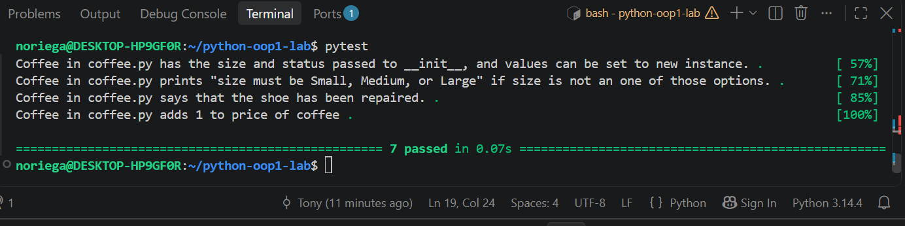

# Python OOP Lab: Bookstore

A small Python project that models two objects a bookstore might carry: a `Book` and a `Coffee`. It practices creating classes, validating input with properties, and writing methods.

## Features

### Book (`lib/book.py`)
- **Attributes:** `title`, `page_count`
- **Validation:** `page_count` must be an integer. Otherwise it prints `page_count must be an integer`.
- **Method:** `turn_page()` prints `Flipping the page...wow, you read fast!`

### Coffee (`lib/coffee.py`)
- **Attributes:** `size`, `price`
- **Validation:** `size` must be `Small`, `Medium`, or `Large`. Otherwise it prints `size must be Small, Medium, or Large`.
- **Method:** `tip()` prints `This coffee is great, here's a tip!` and increases the price by 1.

## Setup

```
pipenv install
pipenv shell
```

## Running the tests

```
pytest -x lib/testing/book_test.py
pytest -x lib/testing/coffee_test.py
```

## Example usage

```python
from lib.book import Book
from lib.coffee import Coffee

book = Book("Dune", 412)
book.turn_page()

coffee = Coffee("Large", 5)
coffee.tip()
print(coffee.price)  # 6
```

## Screenshot of completed work

